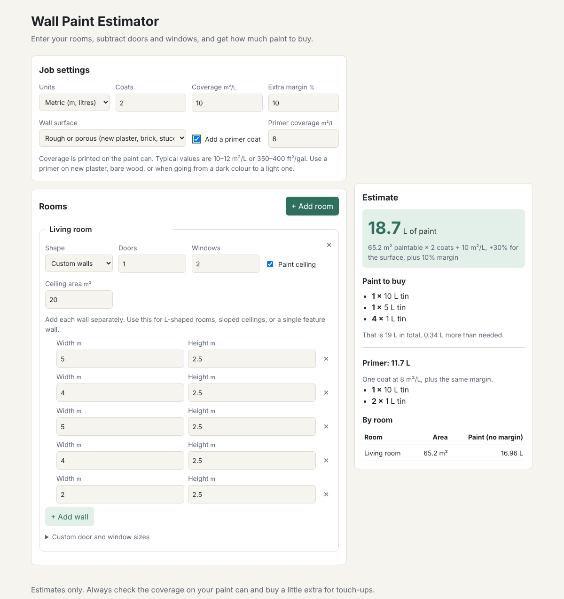

# PaintWise

**How much paint do I actually need?** PaintWise answers that in a few seconds.

You enter your rooms, and it tells you how many litres (or gallons) of paint to buy, and which cans to pick up at the store. It's made for painting contractors writing up a job and for homeowners doing it themselves.

**Try it:** [lahanas.github.io/PaintWise](https://lahanas.github.io/PaintWise)



## Why I built it

Working out paint by hand is easy to get wrong. You have to measure every wall, take out the doors and windows, multiply by the number of coats, and check the coverage on the can. Most people end up guessing. Then they either make a second trip to the store or are left with half a can in the garage. I wanted a tool that does the math properly and still feels simple to use.

## What it does

- **Room by room:** add as many rooms as you need, and see how much paint each one takes.
- **Doors and windows are taken out** automatically, using standard sizes or your own measurements.
- **Odd-shaped rooms:** switch a room to "custom walls" and enter each wall on its own (for L-shaped rooms, a sloped ceiling or a single feature wall).
- **Real-world details:** number of coats, the coverage printed on your can, rough or textured walls (which soak up more paint), and an optional primer coat.
- **A shopping list, not just a number:** it picks the mix of can sizes that leaves you with the least paint left over.
- **Metric or imperial:** switch between metres/litres and feet/gallons at any time, and your measurements convert automatically.
- **Remembers your job:** close the page, come back later, and everything is still there.

## How the estimate works

```
wall area = 2 × (length + width) × height − doors − windows
paint     = wall area × coats × surface factor ÷ coverage + safety margin
```

Rough walls add 15–30% paint, and the safety margin (10% by default) covers spills and touch-ups.

## How it's built

- **Plain HTML, CSS and JavaScript.** There's no framework and no build step, so the app loads instantly and is free to host on GitHub Pages.
- **The math is separate from the page.** All the calculations live in [`src/estimator.js`](src/estimator.js) and don't depend on the browser, which makes them easy to test and reuse.
- **Tested.** Unit tests cover the math with Node's built-in test runner, and they run on every push with GitHub Actions.
- **Responsive and accessible.** It works on a phone on the job site, and it supports dark mode.

## Run it yourself

```sh
git clone https://github.com/Lahanas/PaintWise.git
cd PaintWise
npx serve .     # then open the link it prints
npm test        # run the tests
```

## What's next

- [x] v0.1: rooms, doors and windows, coats, coverage, can sizes
- [x] v0.2: custom walls, surface types, primer
- [ ] v0.3: paint prices and a printable quote for clients
- [ ] v0.4: save and share projects

## License

MIT
