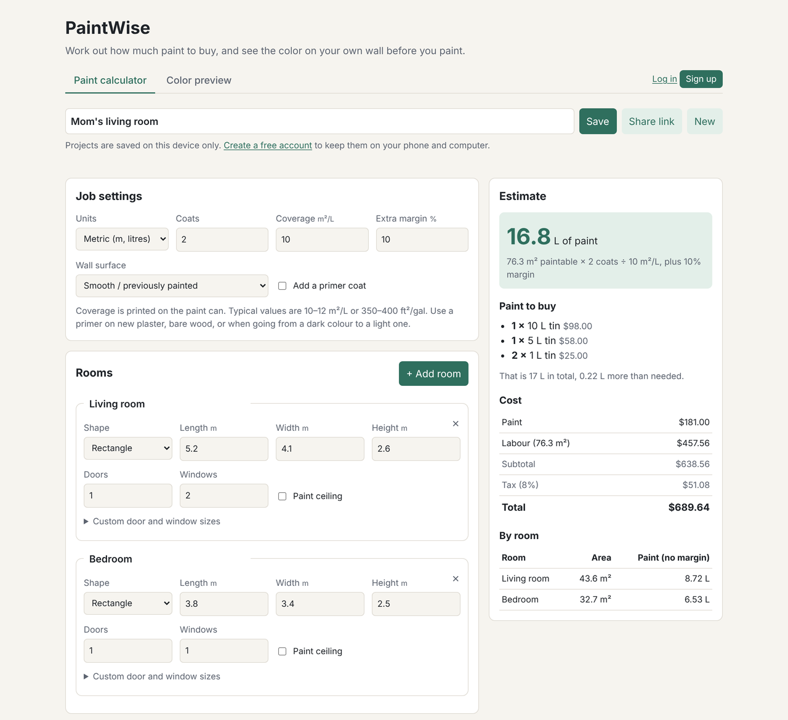
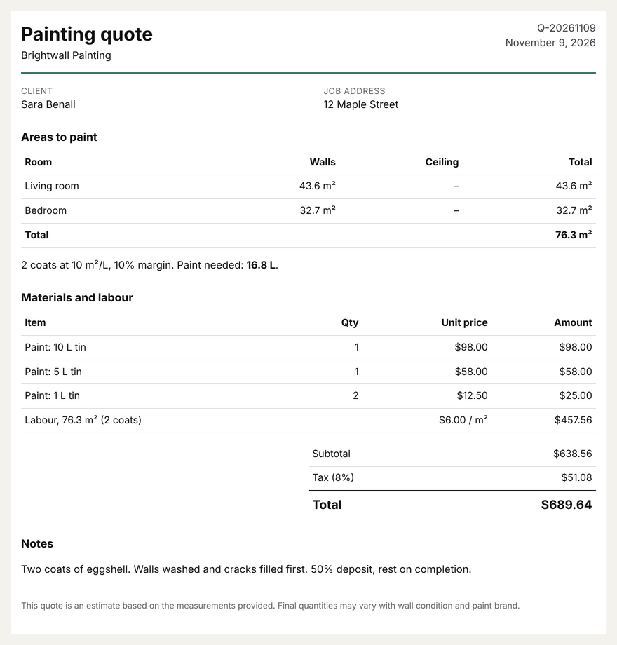
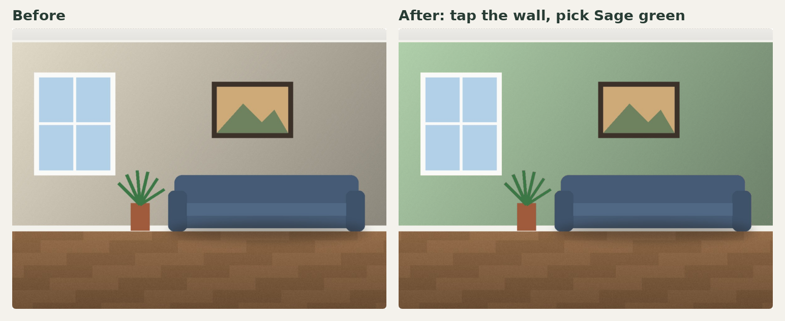
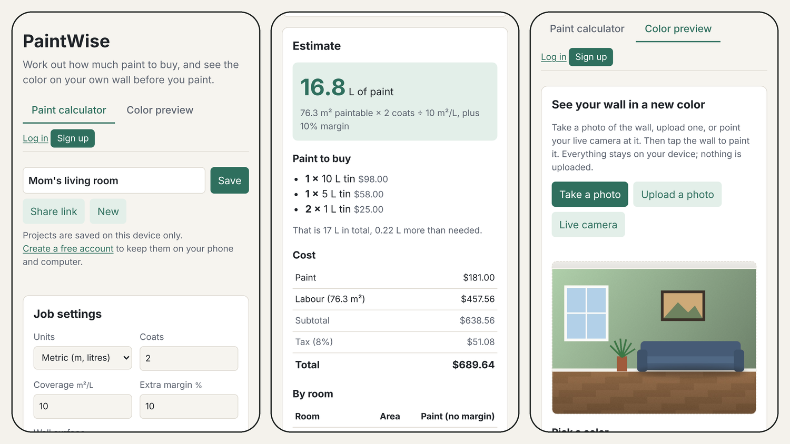
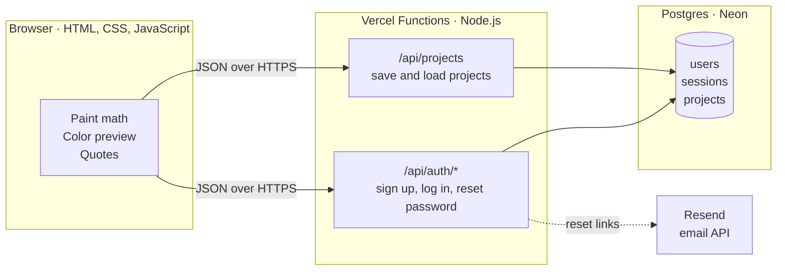

<div align="center">

# 🎨 PaintWise

**Know exactly how much paint to buy, and see the color on your wall before you buy it.**

[](https://paintwise-ten.vercel.app)

[](https://github.com/Lahanas/PaintWise/actions/workflows/test.yml)


[Try it](https://paintwise-ten.vercel.app) · [Features](#-what-it-does) · [How it's built](#-how-its-built) · [How the tricky parts work](#-how-the-tricky-parts-work) · [Run it locally](#-run-it-yourself)



</div>

## 💡 Why I built it

This past summer, my parents decided to repaint the house and change the colors. The hardest part wasn't choosing the colors. It was figuring out how much paint we'd actually need. Between measuring every wall, skipping the doors and windows, and counting coats, we ended up guessing, and we overbought. A lot of paint went unused.

So I built PaintWise: a tool that does that math properly and still feels simple, so the next family (or the next painting contractor) buys the right amount the first time.

## ✨ What it does

### 📐 A paint calculator that thinks like a painter
- Add every room, and PaintWise takes out **doors and windows**, counts **coats**, and uses the **coverage printed on your can**.
- Odd-shaped room? Enter **each wall on its own** (L-shaped rooms, sloped ceilings, a single feature wall).
- Rough walls soak up more paint, so **surface type** and an optional **primer coat** are built in.
- **Metric or imperial**, switchable at any time. Your measurements convert automatically.

### 🛒 A shopping list, not just a number
It doesn't just say "16.8 litres". It tells you **which cans to buy**: the mix of can sizes that leaves the least paint over, or, once you add your store's prices, **the cheapest mix** (one big bucket often costs less than three small tins).

### 🧾 Quotes for contractors
Add a labour rate and tax to get the full job cost, fill in the client's details, and print a clean one-page quote or save it as a PDF.

<div align="center">

</div>

### 📸 See the color on your own wall
Point your phone's **live camera** at a wall (or take or upload a photo), tap the wall, and it repaints it in the color you pick, keeping the room's **light and shadows**. Hold a button to compare before and after. The photo never leaves your phone.

<div align="center">

</div>

### ☁️ Accounts, cloud projects and share links
- Create a free account and your projects are **saved online**: measure on your phone at the job site, finish the quote on your laptop.
- No account? Everything still works, and projects are saved on your device.
- Send any project as a **link**. Whoever opens it gets their own copy, no account needed.
- Forgot your password? Get a **reset link by email**.

### 📱 Made for phones first

<div align="center">

</div>

## 🏗 How it's built



| Layer | Tech | Why |
| --- | --- | --- |
| Frontend | Plain HTML, CSS and JavaScript (ES modules) | No framework and no build step, so it loads instantly on a phone at the job site |
| Backend | Vercel Functions (Node.js) | Each file in `api/` is one endpoint. No server to look after, and it scales to zero |
| Database | Postgres on Neon | Real relational data (users own projects), with each project stored as `jsonb` so the app can grow without migrations |
| Email | Resend | Simple HTTP API for password reset emails |
| Quality | Node test runner, Playwright, TypeScript type checking, GitHub Actions | Every push is tested automatically before it goes live |

**The logic is kept separate from the page.** The paint math ([`src/estimator.js`](src/estimator.js)), the wall recoloring ([`src/recolor.js`](src/recolor.js)) and project sharing ([`src/projects.js`](src/projects.js)) don't touch the browser, so they're easy to test on their own.

**It works with or without the backend.** If the API isn't there (for example on GitHub Pages), the account features hide themselves and projects are saved on the device.

## 🧠 How the tricky parts work

<details>
<summary><b>Picking the cheapest mix of paint cans</b></summary>
<br>

Buying 16.8 L sounds simple, until cans come in 1, 2.5, 5 and 10 L and a 10 L bucket costs less per litre than four small tins. Trying every combination gets slow, so it uses **dynamic programming**: it works out the cheapest way to reach every amount on a small grid (based on the greatest common divisor of the can sizes), then picks the cheapest amount that covers what you need. Without prices, the same method finds the fewest cans with the least paint left over. See `pickCans` in [`src/estimator.js`](src/estimator.js).
</details>

<details>
<summary><b>Repainting a wall in a photo so it still looks real</b></summary>
<br>

When you tap the wall, a **flood fill** spreads out from that point and selects every connected pixel with a similar color, stopping at sharp edges like door frames, furniture or a picture. The color comparison cares more about **hue than brightness**, so a wall that's lighter near the window and darker in the corner is still picked up as one wall. Then each selected pixel gets the new color but **keeps its original brightness**, so shadows and lighting stay realistic. In live camera mode, the same steps run on every frame at a smaller size so it stays smooth on a phone. See [`src/recolor.js`](src/recolor.js).
</details>

<details>
<summary><b>Building secure accounts without an auth library</b></summary>
<br>

- Passwords are hashed with **scrypt** and a random salt per user. They are never stored or logged as typed.
- Logging in creates a random session token, sent in an **`HttpOnly`, `Secure`, `SameSite=Lax` cookie**. The database only keeps a **SHA-256 hash** of it, so a database leak doesn't expose live sessions.
- Every project query is **filtered by the logged-in user**, so nobody can read or edit someone else's project, even by guessing its id.
- Write requests must be JSON, which blocks **cross-site form attacks (CSRF)**.
- A wrong email and a wrong password take the same time and give the same message, so attackers **can't tell which emails have accounts**.
- **Rate limits** stop password guessing: after 8 failed logins on one account (or 30 from one network) in 15 minutes, logins pause for a while.
- **Password reset links** are random, single use, expire after an hour, and are stored only as a hash.
- Changing or resetting a password **logs you out on every other device**.
</details>

<details>
<summary><b>Sharing a whole project in a link, with no database</b></summary>
<br>

A share link carries the entire project inside the URL: the project is turned into JSON, **compressed** with the browser's built-in `CompressionStream`, and encoded as URL-safe base64 after `#p=`. The part after `#` is never sent to a server, so shared projects stay private and work even without an account. See [`src/projects.js`](src/projects.js).
</details>

## ✅ Testing

Every push runs three checks on GitHub Actions:

| Check | What it covers |
| --- | --- |
| **51 unit and API tests** (`npm test`) | The paint math, can picking, recoloring and share links, plus every API endpoint, run against a **real Postgres** (PGlite, Postgres compiled to WebAssembly): sign-up, login, sessions, rate limits, password reset, and making sure one user can't touch another user's projects |
| **Browser tests** (`npm run test:e2e`) | [Playwright](https://playwright.dev) opens the app in a real Chrome, on a **desktop and a phone** screen, and clicks through it like a user: measuring a room, painting a wall on a photo, signing up, saving a project, sharing a link, and resetting a forgotten password using the link from the email |
| **Type checking** (`npm run typecheck`) | The code stays plain JavaScript, but TypeScript checks the logic and the backend for mistakes like a missing value or a wrong argument |

## 📡 API

<details>
<summary>All endpoints</summary>
<br>

| Method | Endpoint | What it does |
| --- | --- | --- |
| `POST` | `/api/auth/signup` | Create an account and log in |
| `POST` | `/api/auth/login` | Log in |
| `POST` | `/api/auth/logout` | Log out |
| `GET` | `/api/auth/me` | Who is logged in |
| `POST` | `/api/auth/password` | Change your password |
| `POST` | `/api/auth/forgot` | Email a password reset link |
| `POST` | `/api/auth/reset` | Choose a new password from the link |
| `GET` | `/api/projects` | List your projects |
| `POST` | `/api/projects` | Save a new project |
| `GET` | `/api/projects/:id` | Open a project |
| `PUT` | `/api/projects/:id` | Update a project |
| `DELETE` | `/api/projects/:id` | Delete a project |
</details>

## 🚀 Run it yourself

```sh
git clone https://github.com/Lahanas/PaintWise.git
cd PaintWise
npm install
npm run dev         # http://localhost:3000, with a local database, no setup needed
npm test            # unit and API tests
npm run test:e2e    # browser tests (first time: npx playwright install chromium)
npm run typecheck   # type checking
```

Locally, emails such as password reset links are printed in the terminal instead of being sent.

<details>
<summary>Deploy your own copy on Vercel</summary>
<br>

1. Import the repo on [Vercel](https://vercel.com).
2. Add a Postgres database from **Storage → Neon** and connect it to the project, then redeploy. The tables are created on the first request.
3. **Password reset emails (optional).** Create a free [Resend](https://resend.com) account and an API key, add it in Vercel under **Settings → Environment Variables** as `RESEND_API_KEY`, and redeploy. Until you verify your own domain on Resend, it only delivers to your own email. With a verified domain, also set `MAIL_FROM` (for example `PaintWise <hello@yourdomain.com>`). You can set `APP_URL` so reset links always point to your site.

Without the email key, the app works the same, just without the "Forgot your password?" link.
</details>

## 🗺 Roadmap

- [x] **v0.1** Rooms, doors and windows, coats, coverage, can sizes
- [x] **v0.2** Custom walls, surface types, primer
- [x] **v0.3** Color preview on a photo of your wall
- [x] **v0.4** Paint prices and a printable quote for clients
- [x] **v0.5** Live camera preview, save and share projects
- [x] **v0.6** Backend with accounts and projects saved in the cloud
- [x] **v0.7** Password reset by email, login rate limits, type checking, browser tests
- [ ] **Next** Install it on your phone like an app, and use it offline at the job site
- [ ] **Later** Measure a wall from a photo, and color palettes from real paint brands

## 👋 About me

I'm Anas, and PaintWise is my side project. If you have feedback or ideas, [open an issue](https://github.com/Lahanas/PaintWise/issues) or find me on GitHub at [Lahanas](https://github.com/Lahanas).

## License

MIT
